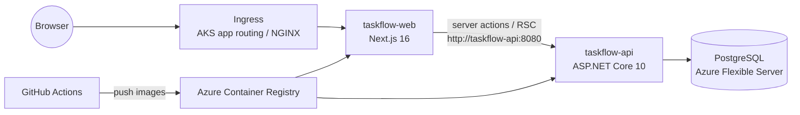
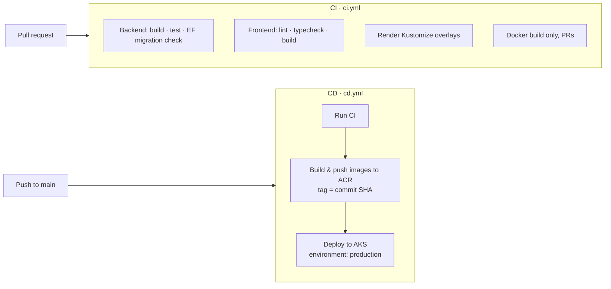

# TaskFlow — ASP.NET Core 10 · Next.js · PostgreSQL · Docker · Kubernetes · Azure

A full-stack starter: a task list app with a .NET 10 minimal API, a Next.js 16 frontend,
PostgreSQL, Docker images, Kubernetes manifests (Kustomize), Azure infrastructure (Bicep)
and a GitHub Actions CI/CD pipeline that deploys to Azure Kubernetes Service.



The browser only talks to Next.js. Next.js server components and server actions call the API
over cluster DNS, so the API is never exposed publicly and no CORS is needed in production.

## Repository layout

```
backend/                     ASP.NET Core 10 API
  src/TaskFlow.Api/          Minimal API, EF Core + Npgsql, health checks, migrations
  tests/TaskFlow.Api.Tests/  xUnit integration tests (WebApplicationFactory)
  Dockerfile
frontend/                    Next.js 16 (App Router, TypeScript, standalone output)
  Dockerfile
k8s/
  base/                      Deployments, Services, Ingress
  overlays/local/            + in-cluster Postgres, local images (Docker Desktop / kind)
  overlays/azure/            + AKS ingress class, HPAs, PodDisruptionBudgets, ACR images
infra/
  main.bicep                 Log Analytics, ACR, AKS, PostgreSQL Flexible Server
  bootstrap.sh               One-time Azure + GitHub OIDC setup
.github/workflows/
  ci.yml                     Build, test, lint, migration check, manifest render
  cd.yml                     CI → build & push to ACR → deploy to AKS
docker-compose.yml           Local dev stack
```

## API

| Method | Route              | Description            |
|--------|--------------------|------------------------|
| GET    | `/api/tasks`       | List tasks             |
| GET    | `/api/tasks/{id}`  | Get one                |
| POST   | `/api/tasks`       | `{ "title": "..." }`   |
| PUT    | `/api/tasks/{id}`  | `{ "title", "isDone" }`|
| DELETE | `/api/tasks/{id}`  | Delete                 |
| GET    | `/health/live`     | Liveness probe         |
| GET    | `/health/ready`    | Readiness (checks DB)  |
| GET    | `/openapi/v1.json` | OpenAPI (Development)  |

## Prerequisites

- [.NET 10 SDK](https://dotnet.microsoft.com/download/dotnet/10.0)
- Node.js 22+
- Docker Desktop (enable Kubernetes in settings for the local cluster option)
- For Azure: [Azure CLI](https://learn.microsoft.com/cli/azure/install-azure-cli), [GitHub CLI](https://cli.github.com/), an Azure subscription

## Run locally

### Option A — everything in Docker

```bash
docker compose up --build
```

Web: http://localhost:3000 · API: http://localhost:5080/api/tasks

### Option B — run the apps directly (fast inner loop)

```bash
docker compose up -d db                       # just PostgreSQL

cd backend
dotnet tool restore
dotnet run --project src/TaskFlow.Api         # http://localhost:5080, migrates on startup

cd ../frontend
cp .env.example .env.local
npm install
npm run dev                                   # http://localhost:3000
```

### Option C — local Kubernetes (Docker Desktop)

```bash
# NGINX ingress controller (once)
kubectl apply -f https://raw.githubusercontent.com/kubernetes/ingress-nginx/controller-v1.12.0/deploy/static/provider/cloud/deploy.yaml

docker build -t taskflow-api:local backend
docker build -t taskflow-web:local frontend
kubectl apply -k k8s/overlays/local
kubectl get pods -n taskflow -w
```

Open http://localhost/. With kind or minikube, load the images first
(`kind load docker-image taskflow-api:local taskflow-web:local`).

## Tests and checks

```bash
cd backend
dotnet test TaskFlow.slnx
dotnet ef migrations has-pending-model-changes --project src/TaskFlow.Api

cd ../frontend
npm run lint && npm run typecheck && npm run build
```

### Adding a database migration

```bash
cd backend
dotnet ef migrations add <Name> --project src/TaskFlow.Api --output-dir Data/Migrations
```

In Kubernetes, migrations are applied by the API pod's `migrate` init container
(`dotnet TaskFlow.Api.dll --migrate-only`) before the new version starts serving.

## Deploy to Azure

### 1. Push the code to GitHub

```bash
git init -b main
git add .
git commit -m "Initial commit"
gh repo create <your-user>/docker-and-kubernetes-app --private --source . --push
```

### 2. Provision Azure and wire up GitHub (one time)

> New subscriptions: register the resource providers first (once):
> `for p in Microsoft.ContainerService Microsoft.ContainerRegistry Microsoft.DBforPostgreSQL Microsoft.OperationalInsights Microsoft.OperationsManagement Microsoft.Insights; do az provider register -n $p --wait; done`
>
> Regions: some subscriptions can't create standard VM or PostgreSQL sizes in every region.
> `infra/main.bicepparam` sets AKS to Central India and PostgreSQL to Southeast Asia; change
> `location` / `postgresLocation` / `aksNodeVmSize` there if your subscription allows others.

In **Azure Cloud Shell (bash)**, WSL or Git Bash, signed in with `az login` and `gh auth login`:

```bash
./infra/bootstrap.sh <your-user>/docker-and-kubernetes-app rg-taskflow southeastasia
```

This deploys `infra/main.bicep` (ACR, AKS with the app routing add-on, PostgreSQL Flexible Server,
Log Analytics) and creates a **user-assigned managed identity** that trusts GitHub through
**OIDC federated credentials** (it needs only Azure RBAC rights, not Entra ID app-registration rights).
No Azure passwords are stored in GitHub. It then sets:

| Kind     | Name                                                                 |
|----------|----------------------------------------------------------------------|
| Secrets  | `AZURE_CLIENT_ID`, `AZURE_TENANT_ID`, `AZURE_SUBSCRIPTION_ID`, `DB_CONNECTION_STRING` |
| Variables| `AZURE_RESOURCE_GROUP`, `ACR_NAME`, `AKS_NAME`                      |
| Environment | `production` (add required reviewers in repo settings for manual approval) |

### 3. Ship it

Push to `main` (or run **CD** manually from the Actions tab). Then find the public address:

```bash
az aks get-credentials -g rg-taskflow -n taskflow-aks
kubectl get ingress -n taskflow
```

The workflow run summary also prints the URL.

## CI/CD pipeline



- **CI** runs on every pull request and on pushes to other branches.
- **CD** runs on `main`: reruns CI, builds both images tagged with the commit SHA, pushes them to ACR,
  updates the database secret, sets the image tags with Kustomize, applies the manifests and waits for rollout.
- Protect `main` in GitHub (Settings → Branches) and require the CI checks to pass before merging.

## Cost and production notes

- The defaults (2 × `Standard_D2as_v5` nodes, Burstable B1ms PostgreSQL, Basic ACR) cost roughly
  what a small dev environment does. Stop the cluster when idle: `az aks stop -g rg-taskflow -n taskflow-aks`.
  Delete everything with `az group delete -n rg-taskflow`.
- For production, consider: PostgreSQL private networking (VNet integration) instead of the
  "allow Azure services" firewall rule, Workload Identity + Entra auth to PostgreSQL instead of a password,
  a custom domain + TLS on the ingress (cert-manager or Key Vault certificates with app routing),
  and Azure Key Vault (CSI driver) for secrets.
